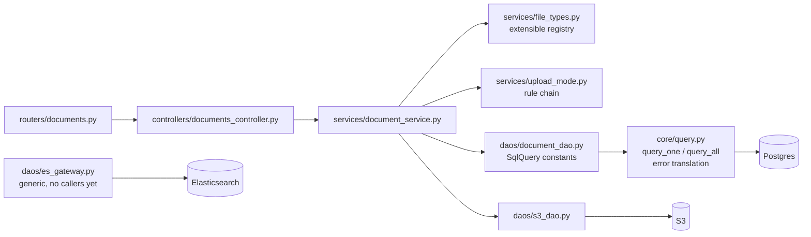
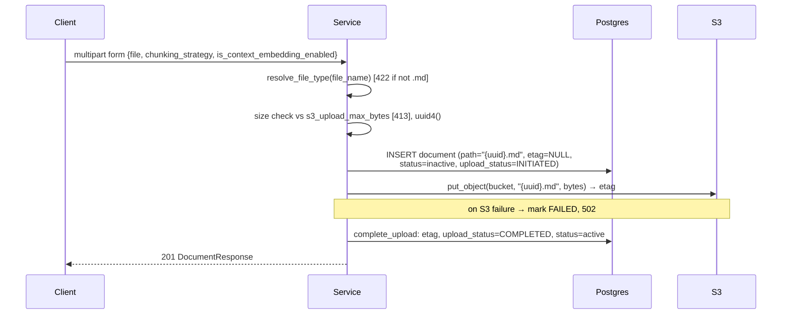
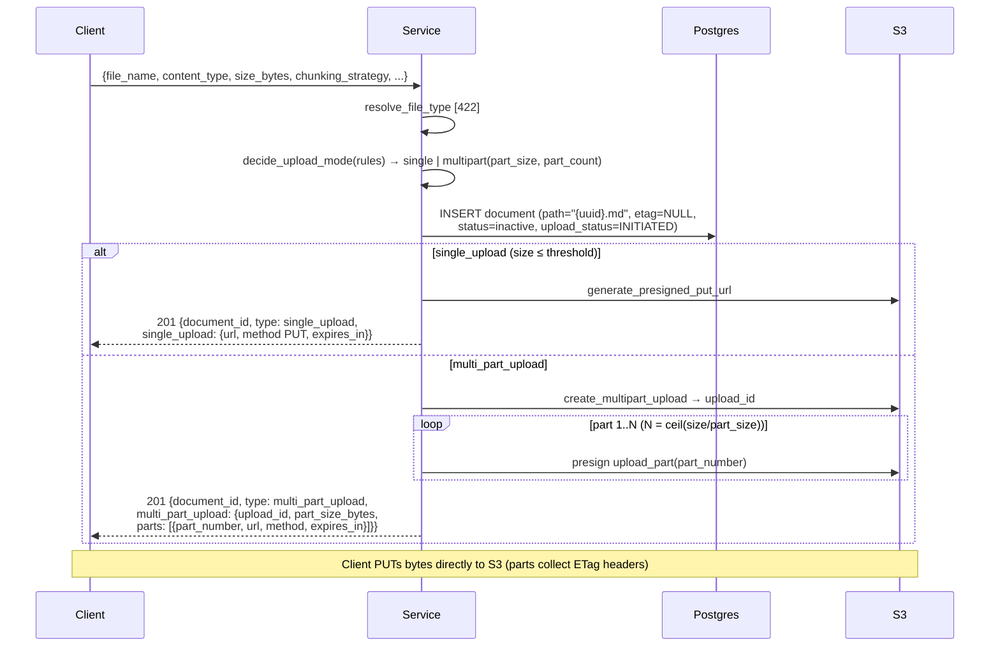
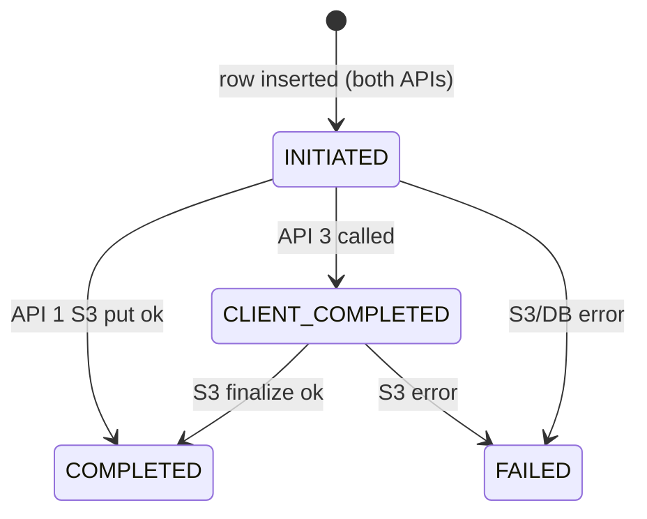

# Document Upload API Redesign — 3 APIs, JDBI-style DAO layer

## Context

The service currently exposes ~18 routes (document CRUD, chunk CRUD, chunk-content CRUD, generic uploads). We are replacing the entire API surface with exactly **3 document-upload APIs** (plus `GET /health`), and restructuring the data-access layer per the mandated format:

- **>3 args → context DTO** (parameter-object pattern) at every layer.
- **Postgres → JDBI-style declarative queries**: SQL declared once as query constants with a row mapper; a generic executor runs them with a params dict ("call it with data").
- **Elasticsearch → generic gateway**: `(index, query/body) → response`, kept as infrastructure for the upcoming chunking pipeline.
- **Extensible file-type validation** (registry; `.md` only today) and **extensible upload-mode rules** (config threshold rule today).

**User-approved decisions:** full dead-code cleanup (chunk/upload routers→services→DAOs→DTOs→tests deleted; chunk DDL + dataclass models kept); `upload_status` enum **replaced** with `INITIATED / CLIENT_COMPLETED / COMPLETED / FAILED` (dev DB drop/recreate acceptable); **no server-side multipart state** — S3 `upload_id` is returned to the client and passed back on complete; **`path` stores the S3 key at insert** (approved deviation from "path empty" — API 3 needs the key and we store no other state).

## Target API surface

| Route | Purpose |
|---|---|
| `GET /health` | unchanged |
| `POST /documents` | API 1 — direct upload (multipart form: file + options) |
| `POST /documents/presigned-upload` | API 2 — create presigned upload (single or multipart by rules) |
| `POST /documents/presigned-upload/complete` | API 3 — finalize presigned upload |

## Architecture (target)



## Flow diagrams

### API 1 — `POST /documents` (direct upload)


### API 2 — `POST /documents/presigned-upload`


### API 3 — `POST /documents/presigned-upload/complete`
```mermaid
sequenceDiagram
    participant CL as Client
    participant API as Service
    participant PG as Postgres
    participant S3 as S3
    CL->>API: {document_id, upload_id?, parts?: [{part_number, etag}]}
    API->>PG: get_by_id [404 if missing]
    API->>API: state guard: INITIATED|CLIENT_COMPLETED ok;<br/>COMPLETED/FAILED → 409. Shape guard:<br/>upload_id ⇒ parts required; no upload_id ⇒ no parts [422]
    API->>PG: set upload_status = CLIENT_COMPLETED
    alt multipart (upload_id present)
        API->>S3: complete_multipart_upload(bucket, doc.path, upload_id,<br/>parts sorted by part_number) → final etag
    else single
        API->>S3: head_object(bucket, doc.path) → etag
    end
    Note over API,S3: object/upload missing → 409; other S3 error → FAILED + 502
    API->>PG: complete_upload: etag, upload_status=COMPLETED, status=active
    API-->>CL: 200 DocumentResponse
```

### upload_status lifecycle


## Key designs

### 1. JDBI-style query interface — `app/core/query.py` (new)
```python
@dataclass(frozen=True)
class SqlQuery[T]:
    name: str                              # for error messages
    sql: str                               # named placeholders: %(field)s
    mapper: Callable[[dict[str, Any]], T]  # row dict → domain object

def query_one[T](query: SqlQuery[T], params: Mapping[str, Any]) -> T | None: ...
def query_all[T](query: SqlQuery[T], params: Mapping[str, Any]) -> list[T]: ...
```
Executor calls `ensure_schema()`, runs on the shared connection with `dict_row`, and translates `UniqueViolation → PostgresConflictError`, `psycopg.Error → PostgresDaoError` **once** (removes per-function try/except in DAOs).

`document_dao.py` rewritten as declared query constants + thin callables:
`_INSERT` (etag NULL, status/upload_status baked into SQL), `_GET_BY_ID`, `_SET_UPLOAD_STATUS`, `_COMPLETE_UPLOAD` (sets etag, `upload_status='COMPLETED'`, `status='active'`, `updated_at=now()`), all `RETURNING <columns>` → `Document(**row)`. Public: `insert(record: NewDocumentRecord)`, `get_by_id(id)`, `set_upload_status(id, status)`, `complete_upload(id, etag)`. List/update/delete removed (no API needs them).

### 2. ES gateway — `app/daos/es_gateway.py` (new, no callers yet)
`search(index, body)`, `index_document(index, doc_id, document)`, `get_document(index, doc_id) → dict | None`, `delete_document(index, doc_id) → bool`; wraps `ApiError → ElasticsearchDaoError`. `app/core/elasticsearch.py` stays.

### 3. File-type registry — `app/services/file_types.py` (new)
`FileType(extension, content_type)` frozen dataclass; `_REGISTRY = {".md": FileType(".md", "text/markdown")}`; `resolve_file_type(file_name) → FileType` raises `DocumentInvalidFileError`. New type = one registry entry.

### 4. Upload-mode rule chain — `app/services/upload_mode.py` (new)
`Rule = Callable[[UploadModeContext], UploadPlan | None]` (None = "not my decision"); ordered `_RULES` list, first non-None wins, default `single_upload`. Today one rule: `size > s3_multipart_threshold_bytes → UploadPlan("multi_part_upload", part_size, ceil(size/part_size))`; guard `> s3_multipart_max_parts → 422`.

### 5. S3 DAO additions — `app/daos/s3_dao.py`
Keep `put_object`, `generate_presigned_put_url`; drop `upload_fileobj`. Add:
- `create_multipart_upload(bucket, key, content_type) → upload_id`
- `generate_presigned_upload_part_url(ctx: PresignPartContext) → url` (`bucket, key, upload_id, part_number, expires_in`)
- `complete_multipart_upload(ctx: CompleteMultipartContext) → etag` (`bucket, key, upload_id, parts: list[(part_number, etag)]`)
- `head_object_etag(bucket, key) → etag`
New `S3ObjectMissingError(S3DaoError)` in `dao_errors.py` for NoSuchKey/NoSuchUpload/InvalidPart[Order] — distinguishes "client lied about upload state" (409) from backend failure (502).

### 6. Context DTOs (>3 args rule)
Service contexts in `app/models/upload.py` (plain dataclasses; services never import pydantic):
`DirectUploadContext`, `PresignedUploadContext`, `CompleteUploadContext`, plus result `PresignedUploadResult`. Request/response pydantic DTOs in `app/dtos/document_dtos.py` per the spec's response shape (`document_id, type, single_upload | multi_part_upload{upload_id, parts[]}`).

### 7. Errors → HTTP (controller mapping)
| Service error | HTTP |
|---|---|
| `DocumentInvalidFileError` | 422 |
| `DocumentInvalidRequestError` (new — shape mismatch, >10k parts) | 422 |
| `DocumentUploadTooLargeError` | 413 |
| `DocumentNotFoundError` | 404 |
| `DocumentConflictError` (dup etag, already completed) | 409 |
| `DocumentUploadIncompleteError` (new — S3 object/parts missing) | 409 |
| `DocumentServiceError` | 502 |

## Schema & config changes

**`app/core/db.py` DDL** (documents table): `etag text` (nullable; `UNIQUE` stays — PG allows many NULLs), `status` default `'inactive'`, `upload_status` default `'INITIATED'` with `CHECK IN ('INITIATED','CLIENT_COMPLETED','COMPLETED','FAILED')`. `document_chunks` unchanged. *Dev DB needs `docker compose down -v` once (CREATE IF NOT EXISTS won't alter).*

**`app/models/document.py`**: new `UploadStatus` Literal, `etag: str | None`, add `NewDocumentRecord` insert-context dataclass.

**`app/core/config.py`**: add `s3_multipart_threshold_bytes = 100MiB`, `s3_multipart_part_size_bytes = 10MiB` (S3 min part = 5MiB, last part exempt), `s3_multipart_max_parts = 10_000`; drop `s3_document_prefix` (keys are `{uuid}.md` at bucket root per spec).

## File inventory

**Delete (17):** routers/{uploads, document_chunks, document_chunk_content}.py; controllers/{uploads, document_chunks, document_chunk_content}_controller.py; services/{upload, document_chunk, document_chunk_content}_service.py; dtos/{upload, document_chunk, document_chunk_content}_dtos.py; daos/{document_chunk, document_chunk_content}_dao.py; utils/file_utils.py; tests/{test_uploads, test_documents, test_document_upload, test_document_chunks, test_document_chunk_content}.py

**Create:** core/query.py; daos/es_gateway.py; services/file_types.py; services/upload_mode.py; tests/{test_add_document, test_presigned_upload, test_complete_upload}.py (+ shared fakes in tests/conftest.py)

**Rewrite/modify:** core/db.py, core/config.py, models/document.py, models/upload.py, daos/document_dao.py, daos/s3_dao.py, services/document_service.py, errors/{dao_errors, service_errors}.py, dtos/document_dtos.py, api/controllers/documents_controller.py, api/routers/documents.py, main.py (health + documents routers only)

## Implementation order
1. Foundation: config, DDL, models/document.py
2. core/query.py → rewrite document_dao on it
3. s3_dao additions + new dao errors
4. file_types.py, upload_mode.py, models/upload.py contexts
5. document_service.py + service_errors.py
6. DTOs, controller, router, main.py
7. es_gateway.py; delete dead files
8. Tests; `ruff check .` (catches stale imports)

## Test plan (pattern: TestClient + autouse in-memory DAO fakes + moto `mock_aws`)
- **test_add_document.py**: happy path (201, COMPLETED/active, path=`{id}.md`, etag set, object in moto bucket); non-.md → 422 no row; oversize → 413; duplicate etag → 409 + row FAILED; S3 error → 502 + row FAILED.
- **test_presigned_upload.py**: small size → single_upload (one URL, row INITIATED/inactive/etag NULL); size == threshold → single (boundary); threshold+1 → multipart; part-count math (ceil; exact-multiple → no phantom part; each URL has uploadId+partNumber, parts 1..N contiguous); >10k parts → 422; non-.md → 422; presign failure → 502 + FAILED.
- **test_complete_upload.py**: single happy path (put object, complete without upload_id → etag from head, COMPLETED/active); multipart happy path (real moto upload_id, ≥5MiB parts via boto3, final etag `-N` suffix); unknown id → 404; already COMPLETED → 409; object never uploaded → 409; bad upload_id/etag → 409; upload_id without parts → 422; unsorted parts accepted (service sorts); S3 5xx → 502 + FAILED.

## Verification (end-to-end)
1. `docker compose down -v && docker compose up -d` (schema recreate). S3: LocalStack (`docker run -d -p 4566:4566 localstack/localstack`; `LOCALSTACK_ENDPOINT=http://localhost:4566`, test AWS creds, `aws --endpoint-url ... s3 mb s3://practice-bucket`).
2. `uv run uvicorn app.main:app --reload`; `/docs` shows exactly 4 routes.
3. API 1: `curl -F "file=@naive_rag.md" localhost:8000/documents` → 201 COMPLETED; `.txt` → 422; object visible via `aws s3 ls`.
4. API 2+3 single: presign small size → `curl -X PUT -H "Content-Type: text/markdown" --data-binary @f "<url>"` → complete with document_id only → COMPLETED.
5. API 2+3 multipart: 110MB file (`dd`), `split -b 10485760`, PUT each part capturing ETag headers, complete with upload_id+parts → COMPLETED; re-complete → 409.
6. `uv run pytest && uv run ruff check .`

## Risks / gotchas
- **CompleteMultipartUpload 200-with-error-body**: boto3 parses it into `ClientError`; map InvalidPart/InvalidPartOrder/NoSuchUpload → 409, else 502.
- **Multipart etag** is `"<md5-of-md5s>-N"`, not a content MD5 — fine for UNIQUE, not a checksum.
- **Presigned PUT signs Content-Type** — client must send the exact header; browser clients need bucket CORS exposing `ETag`.
- **Abandoned multiparts** accrue cost (no server state by design) — recommend S3 lifecycle rule `AbortIncompleteMultipartUpload` (ops, not code).
- **moto** can't serve presigned URLs in-process — multipart tests drive boto3 directly and assert URL query params; moto enforces 5MiB min part.
