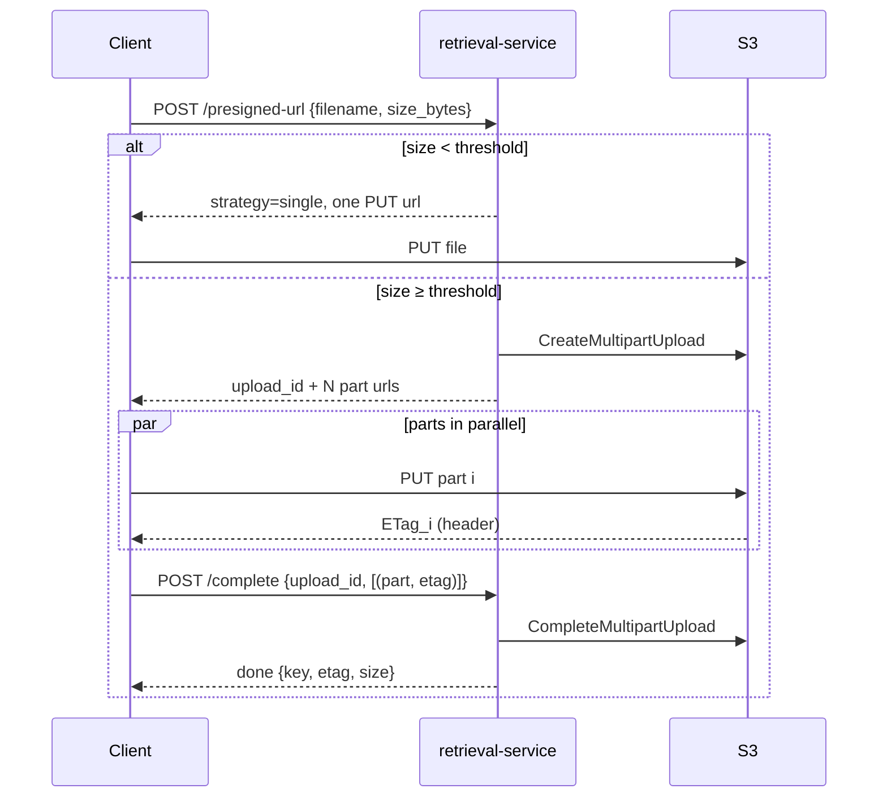

# Smart Multipart Presigned Upload — Solutioning

## Problem

Today `POST /uploads/presigned-url` returns **one** presigned PUT URL. Fine for
small files, but for big ones a single PUT means: no parallelism, and one
network blip = restart the whole upload. S3 also caps a single PUT at 5 GiB.

## Idea (one line)

Client tells us the **file size** upfront → server picks the strategy:
small file → single presigned PUT (today's flow), large file → S3
**multipart upload** (many presigned part URLs, uploaded in parallel).

```
size_bytes < 100 MB  ──►  single presigned PUT   (unchanged)
size_bytes ≥ 100 MB  ──►  multipart presigned    (new)
```

Threshold is config (`s3_multipart_threshold_bytes`), not code.

## How multipart works (the intern version)

S3 natively supports "upload a file as N independent chunks, then I'll stitch
them". Three S3 calls are involved — all made by **our server** (they need
credentials), while the actual **bytes go client → S3 directly**:

1. `CreateMultipartUpload` → S3 returns an `upload_id` (a ticket for this upload).
2. Client PUTs each part to a presigned part-URL. S3 replies to each part with
   an **ETag** header.
3. `CompleteMultipartUpload(upload_id, [(part_number, etag), ...])` → S3 stitches.

### What is an ETag?

A receipt S3 gives you per uploaded part — an opaque hash (MD5 for plain
uploads) of the bytes S3 actually received. At complete-time you hand back
`(part_number, etag)` pairs; S3 verifies each receipt matches the part it has.
Wrong/missing etag → complete fails. The final object's ETag looks like
`"abc123...-4"` (`-4` = built from 4 parts), so it is **not** the file's MD5.

### Who merges the parts?

**S3 does**, server-side, on `CompleteMultipartUpload`. Not us, not the
client. Zero bytes flow through our service. Merge is atomic: the object is
invisible until complete succeeds, then appears whole.

## API design

### 1. `POST /uploads/presigned-url` (extend, backward compatible)

Request gains optional `size_bytes`. Response gains a `strategy` field.

```jsonc
// small file (or size_bytes omitted) → exactly today's response + strategy
{ "strategy": "single", "url": "...", "method": "PUT", ... }

// large file
{
  "strategy": "multipart",
  "bucket": "...", "key": "...",
  "upload_id": "xyz",
  "part_size_bytes": 10485760,
  "parts": [ { "part_number": 1, "url": "https://s3...partNumber=1&uploadId=xyz" }, ... ],
  "expires_in": 3600
}
```

Part-size rule (S3 constraints: min 5 MiB/part except last, max 10,000 parts,
part ≤ 5 GiB): `part_size = max(10 MiB, ceil(size / 10_000))`, number of parts
= `ceil(size / part_size)`.

### 2. `POST /uploads/complete` (new)

```jsonc
{ "key": "...", "upload_id": "xyz",
  "parts": [ { "part_number": 1, "etag": "\"a54d...\"" }, ... ] }
```

Server calls `CompleteMultipartUpload`, returns final `{bucket, key, etag, size_bytes}`.

### 3. `POST /uploads/abort` (new, small)

Calls `AbortMultipartUpload` so S3 deletes orphaned parts (client gave up).

## Flow



## Storage layer (so we can get / read / delete later)

Principle: **S3 owns the bytes, the DB owns the catalog.** Without a catalog
we can't list a user's files, look one up by id, or delete it — S3 keys alone
aren't an API. One table covers all three upload modes, because the modes
only differ in *when* we learn the upload finished — that's a `status`
transition, not a different schema.

### `files` table (one row per file, any mode)

```
id            uuid PK      -- the public API handle; never expose raw S3 keys
bucket, key   text         -- key UNIQUE; where the bytes live
filename      text         -- original name, for display
content_type  text NULL
size_bytes    bigint NULL  -- claimed at presign; verified from S3 on finish
upload_mode   enum: direct | presigned | multipart
status        enum: pending | uploaded | failed | deleted
upload_id     text NULL    -- multipart only; cleared once completed
etag          text NULL    -- set from S3's answer, never from the client
created_at, updated_at, completed_at
```

Start with SQLite locally / Postgres in stage-prod (SQLAlchemy); the schema is
plain enough that the engine doesn't matter yet. New `daos/file_metadata_dao.py`
beside `s3_dao.py` — service layer composes the two.

### When does each mode write what?

| Mode | Row created | → `uploaded` when |
|---|---|---|
| **direct** (`POST /uploads`) | after S3 put succeeds, already `uploaded` | immediately — we streamed the bytes ourselves |
| **single presigned** | at presign time, `pending` | client calls `POST /uploads/{id}/confirm`; server does a **HEAD** on the key and copies real `size_bytes` + `etag` from S3 — never trust the client's word |
| **multipart presigned** | at presign time, `pending` (+ `upload_id`) | our `/uploads/complete` succeeds — we're in that call anyway; store final etag, clear `upload_id` |

The `pending` row is what makes confirm/complete/abort work by `id` alone —
the client no longer needs to carry `bucket`/`key`/`upload_id` around; we look
them up. (The API examples above simplify to `{id, parts:[...]}`.)

### Read / delete API (mode-agnostic — this is the payoff)

- `GET /files` — list rows with `status=uploaded` (paginated).
- `GET /files/{id}` — metadata + a presigned **GET** URL (same pattern as
  upload presigning, direction reversed).
- `DELETE /files/{id}` — if `uploaded`: S3 `delete_object`, then mark row
  `deleted` (soft delete — keeps history, makes retries idempotent). If
  `pending` multipart: `abort_multipart` instead.

### Drift & the never-confirmed presigned upload

The DB is an index of S3, and indexes drift: a single-presigned client may
upload fine but never call confirm, or never upload at all. One reconcile
sweep (cron or on-demand) fixes both: for `pending` rows older than ~1 day,
`HEAD` the key — object exists → mark `uploaded`; doesn't → mark `failed`
(the S3 lifecycle rule has already thrown away any stray parts by then).
Same sweep, both modes, no special cases.

## How do we know the upload finished?

- **Multipart:** the `POST /uploads/complete` call succeeding **is** the
  signal — it's the only path that makes the object exist.
- **Single PUT:** today we never know (client talks straight to S3). Options:
  a `HEAD` check on demand, or later an S3 event notification → that's the
  robust long-term answer for both flows, out of scope here.

## Failure cases & orphan data

Key fact: S3 **never expires a multipart upload on its own** — abandoned
parts are invisible but billed, forever. So:

| What went wrong | What happens | Who cleans up |
|---|---|---|
| Complete **never called** (client crashed / gave up) | parts sit in S3, billed | `/uploads/abort` if client is polite; otherwise the **lifecycle rule** (below) — guaranteed |
| Complete **rejected** (bad/missing etag, missing part) | nothing lost — `upload_id` + parts intact | client re-uploads the bad part and **retries complete** (safe); if it gives up → lifecycle rule |
| Complete **succeeded but response lost** (network blip) | object exists; retry gets `NoSuchUpload` (id consumed on success) | disambiguate with a `HEAD` on the key: object exists → success |
| Part URL **expired** mid-upload | already-uploaded parts survive | client re-requests URLs for the *same* `upload_id` |

**The lifecycle rule is the real safety net** — a one-time bucket config,
`AbortIncompleteMultipartUpload after 1 day`: S3 itself deletes every
incomplete upload older than that. No cron, no DB, no code in our service,
and it catches *every* orphan no matter why the client vanished. The abort
endpoint just saves money faster.

**Implementation gotcha:** `CompleteMultipartUpload` can return HTTP **200
with an error in the body** (S3 streams whitespace while stitching large
objects). boto3 raises on this, but it means `/uploads/complete` must trust
boto3's parsed result, never "the HTTP call didn't throw".

## Code touchpoints (small)

| Layer | Change |
|---|---|
| `dtos/upload_dtos.py` | `size_bytes` on request; multipart response + complete/abort DTOs |
| `daos/s3_dao.py` | `create_multipart_upload`, `presign_upload_part`, `complete_multipart`, `abort_multipart`, `head_object`, `delete_object`, `presign_get_url` |
| `daos/file_metadata_dao.py` | new — CRUD on the `files` table |
| `services/upload_service.py` | strategy pick + part-size math + status transitions |
| `routers` / `controllers` | `/uploads/complete`, `/uploads/abort`, `/uploads/{id}/confirm`, `/files` (list/get/delete) |
| `core/config.py` | `s3_multipart_threshold_bytes` (default 100 MB), DB URL |
